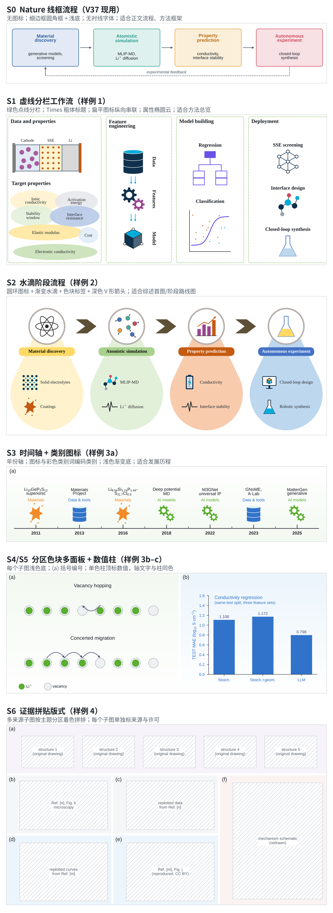

# yikun-figure-style

Yikun 的论文绘图技能：按投稿标准（RSC/Chem. Soc. Rev.、IEEE TVT、Elsevier）用 matplotlib 绘制、重绘或检查论文图件和示意图。



## 能做什么

- **按成图尺寸绘图**：单栏/双栏宽度、最大高度、字号、线宽都按期刊要求设定；导出 600 dpi TIFF、PNG 和矢量 PDF，并报告插入 Word 后的实际 dpi。
- **个人风格库 S0–S6**：Nature 线框流程、虚线分栏工作流、水滴阶段流程、时间轴 + 类别图标、分区色块多面板、单色数值柱、证据拼贴版式。画新图时先按用途挑 2–4 个相近风格，用真实内容各出一张缩略图供选择。
- **数据来源规则**：只用正式发表版数值，不编造数据，图注写明来源类型和许可，图、图注、正文三处数字一致。
- **图注写作**：RSC/IEEE/Elsevier 图注格式、结构顺序、写法规则、反例和模板；每张图同时交付英文图注、中文图注（中文稿）、正文引用句和来源许可核对行。

## 文件

```
yikun-figure-style/
├── SKILL.md              # 技能定义（含完整代码，可单独使用）
├── README.md
├── scripts/
│   ├── pub_fig.py        # 期刊尺寸、配色、数据图函数、导出
│   ├── pub_schem.py      # 毫米坐标示意图基元 + 17 个自绘图标
│   └── demos.py          # S0–S6 示例（ASSB AI4Science 内容）
└── examples/             # 各风格示例图（600 dpi）与总览图
```

## 使用

```bash
cd scripts
python demos.py           # 画出全部示例到 scripts/out/
python demos.py s1 s2     # 只画指定风格
```

依赖：Python 3、matplotlib、numpy、Pillow。默认字体为 Liberation Sans / Liberation Serif（与 Arial / Times New Roman 等宽），没有时会回退到 Arial、Times New Roman 或 DejaVu。

## 来源与许可

- 基础风格规范改写自 Chen Liu 的 [figures4papers](https://github.com/ChenLiu-1996/figures4papers)。该项目采用 CC BY-NC 4.0 许可，本技能作为其改编作品，同样仅限非商业用途，并保留署名。
- 风格库只总结了样例图的视觉规则（配色、版式、图标编码、标注习惯）。仓库里不包含样例原图；图标都是用 matplotlib 图形自绘的简单几何形状。
- `demos.py` 中 S3 的里程碑和 S4(b) 的 MAE 数值来自已发表文献（MAE 取自 Kim et al., J. Chem. Phys. 2026 正式版），用于论文时需补充引用。
